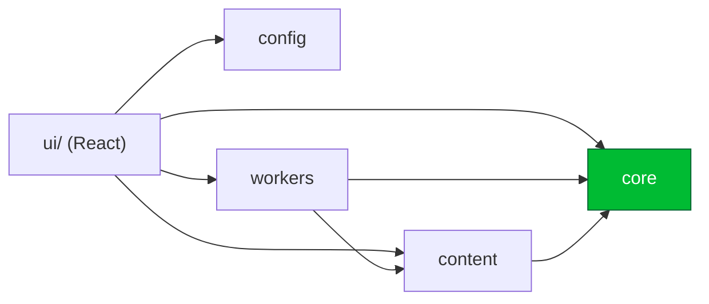
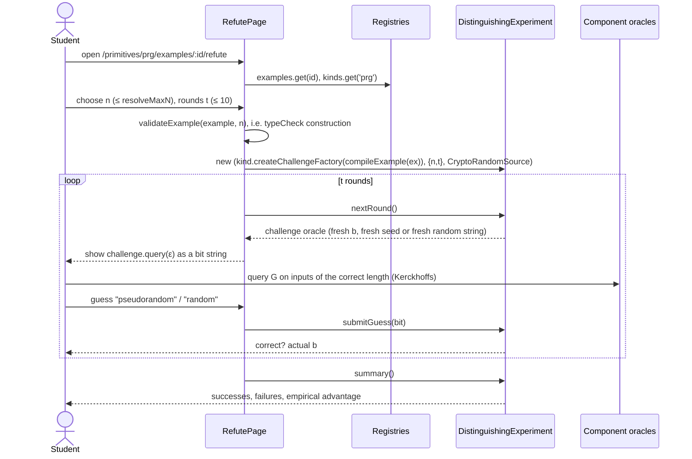
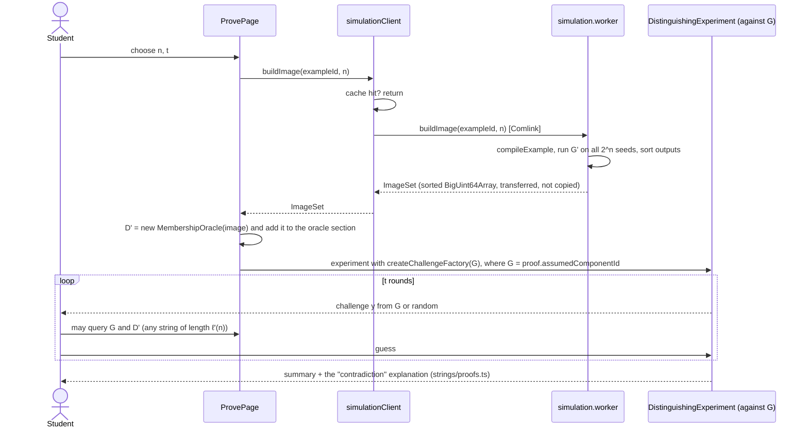

# CryptoCalc — Architecture

> **Status:** proposal (roadmap task 1). The decisions recorded here are binding for later tasks unless they are changed in a pull request that updates this document.
>
> Read together with [`PROJECT_BRIEF.md`](PROJECT_BRIEF.md) (what we build) and [`../CLAUDE.md`](../CLAUDE.md) (how we work).

CryptoCalc is a static, client-side React application. All cryptographic logic lives in a framework-free **core**. Examples, primitive kinds and (later) distinguisher strategies are **data** that register themselves in **registries**. The UI renders whatever the registries contain.

Every part of this document is tagged as **v1** (needed for roadmap tasks 2–5) or **later**. Section 9 explains the split. v1 code never depends on later code.

---

## 1. Tech stack

| Area | Decision | Justification |
|---|---|---|
| Language | **TypeScript**, `strict: true` | The architecture rests on interfaces (oracle, example, registry). Strict typing makes them enforceable. |
| UI library | **React 19** | Required by the brief. A large ecosystem and a familiar portfolio stack. |
| Build tool | **Vite** | Fast dev server, first-class Web Worker support (`new Worker(new URL(...), { type: 'module' })`), and `import.meta.glob` for registering examples without editing an index. |
| Test runner | **Vitest** + **React Testing Library** (jsdom) | Reuses the Vite config and module resolution, including `import.meta.glob`. Jest-compatible API. |
| Router | **React Router** in data mode with `createHashRouter` | GitHub Pages cannot rewrite URLs to `index.html`. Hash URLs make deep links and refreshes always work, with no 404 hacks. |
| LaTeX | **KaTeX**, wrapped in a small own `<Tex>` component that calls `katex.renderToString` | KaTeX is fast and synchronous, so there is no layout flash. An own wrapper avoids an unmaintained React binding and keeps one place to configure macros. |
| Styling | **CSS Modules** + **CSS custom properties** generated from `config/theme.ts` | Scoped styles with no runtime cost. Theme tokens live in one TS file and are exposed as CSS variables, so every component and the "cyber" look can be re-themed by editing that file. |
| Fonts | Self-hosted through `@fontsource/*` packages | No runtime network calls (CLAUDE.md). |
| Worker RPC | **Comlink** | A tiny library that turns a worker into a typed async API, supports transferables and progress callbacks. |
| Lint / format | **ESLint** (flat config) + **typescript-eslint** + `eslint-plugin-react-hooks` + **Prettier** | Standard tooling. ESLint also enforces the layer boundaries (section 2). |
| Package manager | **npm** | Ships with Node. One lockfile (`package-lock.json`). |

**Node version:** development targets **Node 24 (Active LTS)** through `.nvmrc`. `package.json` declares `"engines": { "node": ">=22.12" }`, and CI tests both Node 22 and Node 24. Node is only build tooling: the shipped site is static files.

---

## 2. Folder structure

```
cryptocalc/
├─ .github/workflows/      ci.yml (lint, typecheck, test, build), deploy.yml (GitHub Pages)
├─ docs/                   PROJECT_BRIEF.md, ARCHITECTURE.md
├─ public/                 static assets copied as is (favicon)
├─ src/
│  ├─ core/                PURE TypeScript: no React, no DOM, no config imports
│  │  ├─ bits/             BitString, Bit, LengthExpr, length errors and assertions
│  │  ├─ random/           RandomSource interface, CryptoRandomSource, SeededRandomSource
│  │  ├─ expr/             Expr AST, builder helpers, length type-checker, interpreter
│  │  ├─ oracles/          Oracle interface, BaseOracle, FunctionOracle, LazyRandomOracle,
│  │  │                    MembershipOracle; later: SimulatedOracle, TracingOracle
│  │  ├─ primitives/       PrimitiveKind interface, Target, generic ChallengeFactory implementations
│  │  ├─ examples/         ExampleDefinition, ComponentDefinition, defineExample(), validateExample()
│  │  ├─ experiments/      DistinguishingExperiment state machine, Summary
│  │  ├─ simulation/       exhaustive search: ImageSet (v1); key-consistency search (later)
│  │  ├─ reductions/       (later) ReductionCandidate, DistinguisherStrategy library, AdvantageCalculator
│  │  ├─ registry/         generic Registry<T>
│  │  └─ index.ts          public API of the core
│  ├─ content/             DATA ONLY: built on core types, no logic beyond toy evaluate functions
│  │  ├─ kinds/            PrimitiveKind descriptors: prg.ts, prf.ts (later), hash.ts / eav.ts / cpa.ts / cca.ts (coming soon)
│  │  ├─ components/       building blocks shared by examples (toy PRG G, toy PRF F)
│  │  ├─ prg/examples/     one file per PRG example
│  │  ├─ prf/examples/     one file per PRF example (later)
│  │  └─ registries.ts     builds the registries with import.meta.glob
│  ├─ config/
│  │  ├─ limits.ts         every limit and default
│  │  ├─ theme.ts          design tokens
│  │  └─ strings/          UI strings grouped by feature
│  ├─ workers/
│  │  ├─ simulation.worker.ts   exposes SimulationApi through Comlink
│  │  └─ simulationClient.ts    typed client: lazy worker creation, caching, cancellation
│  ├─ ui/
│  │  ├─ app/              App, router, layout (header, breadcrumbs), providers
│  │  ├─ pages/            HomePage, PrimitivePage, ExamplePage, RefutePage, ProvePage,
│  │  │                    ComingSoonPage, NotFoundPage
│  │  ├─ components/       Tex, RichText, BitStringView, BitStringInput, OracleConsole,
│  │  │                    ExperimentSetup, RoundView, SummaryTable, RevealAnswer, ...
│  │  ├─ hooks/            useExperiment, useSimulation, useRegistries
│  │  └─ styles/           global.css (reset, base), applyTheme.ts
│  └─ main.tsx             entry point
├─ index.html
├─ eslint.config.js, tsconfig*.json, vite.config.ts, vitest.config.ts (or merged), .prettierrc
└─ .nvmrc
```

Tests are co-located (`foo.ts` next to `foo.test.ts`). A few cross-cutting tests (content conformance) live in `src/content/__tests__/`.

### Layer rules



- `core` imports nothing outside `core`. Limits reach the core as function parameters, never through imports.
- `content` imports only `core`.
- Nothing imports `ui` except `main.tsx`.
- An ESLint `no-restricted-imports` rule per folder enforces these rules in CI.

---

## 3. Core abstractions

The sketches below are interfaces and signatures only. Implementations are written in tasks 2–5.

### 3.1 Bit strings with a fixed length (v1)

```ts
// core/bits/BitString.ts
export type Bit = 0 | 1;

/** Immutable bit string. Index 0 is the leftmost (most significant) bit. */
export class BitString {
  private constructor(readonly length: number, readonly value: bigint) {}

  static empty(): BitString;                                  // ε, length 0
  static fromString(bits: string): BitString;                 // "0101", rejects other characters
  static fromBits(bits: readonly Bit[]): BitString;
  static fromBigInt(value: bigint, length: number): BitString; // throws if value ≥ 2^length

  bit(i: number): Bit;
  concat(other: BitString): BitString;
  slice(from: number, to: number): BitString;                 // [from, to)
  xor(other: BitString): BitString;                           // throws LengthMismatchError
  complement(): BitString;
  equals(other: BitString): boolean;
  toString(): string;
}

export class LengthMismatchError extends Error {
  constructor(readonly where: string, readonly expected: number, readonly actual: number);
}
export function assertLength(s: BitString, expected: number, where: string): void;
```

TypeScript cannot track a runtime length `n` in the type system. Fixed length is therefore a **runtime invariant**. Every value carries its length, and every boundary (oracle input and output, experiment challenge, user input) calls `assertLength`. The value is a `bigint`, so lengths beyond 53 bits are safe.

### 3.2 Lengths as data (v1)

```ts
// core/bits/LengthExpr.ts
/** ℓ(n) = mul · n + add. Serializable, so it can cross into the worker and come from the future parser. */
export interface LengthExpr { readonly mul: number; readonly add: number }
export const len = (mul: number, add = 0): LengthExpr => ({ mul, add });
export function evalLength(l: LengthExpr, n: number): number;  // throws unless the result is a non-negative integer
```

`mul` may be a fraction (for example `len(0.5)` for "the first half of the seed"). An example then declares `limits.nStep = 2` so that only even `n` is offered.

### 3.3 Signatures and targets: one shape for PRG and PRF (v1)

A PRG is treated as a keyed function whose input domain is `{ε}`: `G(s) = G_s(ε)`. This single idea lets the PRG and the PRF share oracles, experiments and (later) the reduction framework.

```ts
// core/primitives/Signature.ts
export interface Signature {
  readonly keyLength: LengthExpr;     // PRG: seed length; PRF: key length
  readonly inputLength: LengthExpr;   // PRG: len(0), i.e. domain {ε}; PRF: input length
  readonly outputLength: LengthExpr;
}

export type KeyedFunction = (key: BitString, input: BitString) => BitString;

/** Anything that can be evaluated: a compiled example or a component. */
export interface Target {
  readonly id: string;
  readonly signature: Signature;
  readonly evaluate: KeyedFunction;
}
```

### 3.4 Expressions: one closed language for constructions and reductions (v1 subset)

```ts
// core/expr/Expr.ts
export type Expr =
  | { readonly op: 'key' }                                       // s or k
  | { readonly op: 'input' }                                     // x (ε for a PRG); in a reduction: D''s query
  | { readonly op: 'const'; readonly bits: string }              // literal, '' = ε
  | { readonly op: 'call'; readonly component: string; readonly key: Expr; readonly input: Expr }
  | { readonly op: 'concat'; readonly parts: readonly Expr[] }
  | { readonly op: 'slice'; readonly arg: Expr; readonly from: LengthExpr; readonly to: LengthExpr }
  | { readonly op: 'xor'; readonly left: Expr; readonly right: Expr }
  | { readonly op: 'complement'; readonly arg: Expr }
  // later (task 10), reductions only:
  | { readonly op: 'query'; readonly input: Expr }               // challenge oracle O
  | { readonly op: 'random'; readonly length: LengthExpr };      // reduction's own coins, sampled once per run

// core/expr/builders.ts: makes content files readable
export const key: () => Expr;
export const input: () => Expr;
export const bits: (b: string) => Expr;
export const EPS: Expr;
export const call: (component: string, k: Expr, x?: Expr) => Expr;  // x defaults to EPS (PRG components)
export const cat: (...parts: Expr[]) => Expr;
export const slice: (e: Expr, from: LengthExpr, to: LengthExpr) => Expr;
export const xor: (a: Expr, b: Expr) => Expr;
export const not: (e: Expr) => Expr;

// core/expr/typeCheck.ts
export interface TypeContext {
  readonly n: number;
  readonly signature: Signature;                       // lengths of key and input
  readonly components: ReadonlyMap<string, Signature>;
  readonly oracle?: Signature;                         // later: present only in reductions
}
export function typeCheck(e: Expr, ctx: TypeContext): { ok: true; length: number } | { ok: false; errors: LengthError[] };

// core/expr/evaluate.ts
export interface EvalEnv {
  readonly key: BitString;
  readonly input: BitString;
  readonly components: ReadonlyMap<string, KeyedFunction>;
  readonly oracle?: Oracle;                            // later
}
export function evaluateExpr(e: Expr, env: EvalEnv): BitString;
```

The type-checker runs once per `(example, n)` before any experiment starts. Together with `assertLength` inside every oracle, this makes it impossible for a string of the wrong length to reach an oracle. The future parser will produce the same `Expr`, and the reduction builder UI (later) will edit it.

### 3.5 Randomness, injectable (v1)

```ts
// core/random/RandomSource.ts
export interface RandomSource {
  bits(length: number): BitString;   // uniform over {0,1}^length
  coin(): Bit;
}
export class CryptoRandomSource implements RandomSource { /* crypto.getRandomValues */ }
export class SeededRandomSource implements RandomSource { /* deterministic PRNG, tests only */ }
```

Nothing in `core` calls `Math.random` or `crypto` directly. Every experiment receives a `RandomSource`.

### 3.6 Oracles (v1, with later decorators)

```ts
// core/oracles/Oracle.ts
export interface Oracle {
  readonly id: string;
  readonly inputLength: number;
  readonly outputLength: number;
  query(x: BitString): BitString;    // throws LengthMismatchError for a wrong-length x
}

/** Template method: validates lengths on the way in and out, so subclasses cannot break the contract. */
export abstract class BaseOracle implements Oracle {
  query(x: BitString): BitString;    // assertLength(in) → answer(x) → assertLength(out)
  protected abstract answer(x: BitString): BitString;
}

export class FunctionOracle extends BaseOracle { /* wraps (x) => BitString, deterministic */ }
export class LazyRandomOracle extends BaseOracle { /* truly random function: table + RandomSource; same x → same answer */ }
export class MembershipOracle extends BaseOracle { /* D' for a PRG: input ℓ'(n) bits, output 1 bit = y ∈ Image(G') */ }
// later:
export class SimulatedOracle extends BaseOracle { /* O' = Sim(O): evaluates a reduction Expr with `query` bound to O */ }
export class TracingOracle extends BaseOracle { /* decorator that records queries and answers for the step trace */ }

/** Kerckhoffs's principle: the public algorithm of a component, as an oracle on key ‖ input. */
export function componentOracle(target: Target, n: number): Oracle;
```

### 3.7 Components and the generic example definition (v1)

```ts
// core/examples/ComponentDefinition.ts
export interface ComponentDefinition extends Target {
  readonly symbolTex: string;           // 'G'
  readonly kindId: string;              // 'prg'
  readonly descriptionTex?: string;
  readonly assumedSecure: boolean;      // the building block that is "known to be secure"
}

// core/examples/ExampleDefinition.ts
export interface ExampleDefinition {
  readonly id: string;                  // URL slug, unique within its kind
  readonly kindId: string;              // which PrimitiveKind it belongs to
  readonly order?: number;              // position in the list
  readonly title: string;
  readonly definitionTex: string;       // e.g. G'(s) = G(s) \| G(s)
  readonly signature: Signature;
  readonly components: readonly ComponentDefinition[];          // drives the oracle section
  readonly construction: Expr | { readonly evaluate: KeyedFunction };  // Expr preferred; escape hatch for exotic examples
  readonly answer: { readonly secure: boolean; readonly explanationTex: string };
  readonly proof?: {
    readonly assumedComponentId: string;                         // v1: the PRG/PRF to reduce to
    readonly reductions?: readonly ReductionCandidate[];         // later (task 10)
  };
  readonly limits?: { readonly maxN?: number; readonly minN?: number; readonly nStep?: number };
}

export const defineExample = (e: ExampleDefinition): ExampleDefinition => e;   // typed identity helper
export function validateExample(e: ExampleDefinition, n: number): ValidationResult;
export function compileExample(e: ExampleDefinition): Target;   // turns construction + components into evaluate
```

Example-specific text (title, definition, explanation) lives in the example's own data file, because it is content. Generic UI text lives in `config/strings`.

### 3.8 Primitive kinds (v1)

```ts
// core/primitives/PrimitiveKind.ts
export interface PrimitiveKind {
  readonly id: string;                          // 'prg', 'prf', 'hash', 'eav', ...
  readonly section: 'primitives' | 'experiments';
  readonly status: 'available' | 'coming-soon';
  readonly order: number;
  readonly definitionTex: string;               // formal definition shown on the primitive page
  readonly challengeView: 'value' | 'oracle';   // PRG: show O(ε) as a string; PRF: give a query console
  createChallengeFactory(target: Target): ChallengeFactory;
}
```

Strings for a kind (page title, explanation) are looked up in `config/strings` by `kind.id`. Kinds are content (`content/kinds/*.ts`), so adding EAV security later means adding one descriptor plus its pages, without changing existing kinds.

### 3.9 Challenges and the distinguishing experiment (v1)

```ts
// core/experiments/ChallengeFactory.ts
export interface ChallengeFactory {
  real(n: number, rng: RandomSource): Oracle;    // fresh key/seed on every call → Oracle for target_k
  ideal(n: number, rng: RandomSource): Oracle;   // fresh random string (PRG) / fresh LazyRandomOracle (PRF)
}
export function keyedFunctionChallengeFactory(target: Target): ChallengeFactory;  // used by both PRG and PRF

// core/experiments/DistinguishingExperiment.ts
export interface ExperimentConfig { readonly n: number; readonly rounds: number }
export interface Round { readonly index: number; readonly challenge: Oracle }          // b stays hidden
export interface RoundResult { readonly index: number; readonly guess: Bit; readonly actual: Bit; readonly correct: boolean }
export interface Summary {
  readonly rounds: number; readonly successes: number; readonly failures: number;
  readonly successRate: number;
  readonly empiricalAdvantage: number;  // |Pr̂[guess=1 | b=1] − Pr̂[guess=1 | b=0]|
}

export class DistinguishingExperiment {
  constructor(factory: ChallengeFactory, config: ExperimentConfig, rng: RandomSource);
  nextRound(): Round;                    // new coin b, new seed/key or new random function
  submitGuess(guess: Bit): RoundResult;  // b = 1 means "real", guess 1 means "pseudorandom"
  readonly finished: boolean;
  summary(): Summary;
}
```

The experiment class enforces fresh randomness per round, so no page can forget it. It is a plain state machine, with no timers and no React. `useExperiment` wraps it for the UI.

### 3.10 Registry (v1)

```ts
// core/registry/Registry.ts
export interface Identifiable { readonly id: string }

export class Registry<T extends Identifiable> {
  register(item: T): void;              // throws DuplicateIdError
  get(id: string): T;                   // throws UnknownIdError
  find(id: string): T | undefined;
  list(): readonly T[];
  where(pred: (item: T) => boolean): readonly T[];
}
```

```ts
// content/registries.ts
const kindModules    = import.meta.glob<{ default: PrimitiveKind }>('./kinds/*.ts', { eager: true });
const exampleModules = import.meta.glob<{ default: ExampleDefinition }>('./*/examples/*.ts', { eager: true });

export const kinds    = Registry.from(Object.values(kindModules).map(m => m.default));
export const examples = Registry.from(Object.values(exampleModules).map(m => m.default));
// later: strategies = Registry.from(...core/reductions/strategies)
```

The UI receives the registries through a React context (`RegistriesProvider`), so tests can inject small fake registries. The worker imports `content/registries.ts` itself.

### 3.11 Reduction framework (later, task 10)

```ts
// core/reductions/ReductionCandidate.ts
export interface ReductionCandidate {
  readonly id: string;
  readonly labelTex: string;          // Sim^O(x) = O(0\|x) \| O(1\|x)
  readonly sim: Expr;                 // uses 'input' (D''s query), 'query' (O), 'random'; never 'key'
  readonly correct: boolean;          // revealed after the analysis, for teaching
  readonly explanationTex: string;
}

// core/reductions/DistinguisherStrategy.ts
/** D' as a coroutine: yields queries, receives answers, returns its output bit (1 = "pseudorandom"). */
export type StrategyRun = Generator<BitString, Bit, BitString>;

export interface StrategyContext {
  readonly n: number;
  readonly target: Target;            // D' attacks this construction (it may know it)
  readonly rng?: RandomSource;        // only for randomized strategies
}

export interface DistinguisherStrategy {
  readonly id: string;
  readonly deterministic: boolean;
  appliesTo(signature: Signature, n: number): boolean;
  run(ctx: StrategyContext): StrategyRun;
}
```

The strategy library: random guess (baseline), fixed non-adaptive queries, collision test, equal-halves test, swapped-halves test (x vs x̄), exhaustive key/seed consistency, and adaptive. For the PRG, exhaustive consistency is exactly the membership D' from v1: it queries ε once and checks `y ∈ Image(G')`. It is implemented by wrapping v1's `ImageSet`.

```ts
// core/reductions/AdvantageCalculator.ts
export interface Probabilities { readonly real: number; readonly ideal: number; readonly advantage: number }
export interface AdvantageReport {
  readonly dPrime: Probabilities;   // Pr[D'^{F'_k}=1] over all k,   Pr[D'^{g}=1] over random g
  readonly d: Probabilities;        // Pr[D^{F_k}=1]  over all k,    Pr[D^{f}=1]  over random f, with D = D'∘Sim
  readonly idealMethod: 'exact' | 'sampled';
  readonly samples?: number;
}
export function computeAdvantages(
  target: Target, assumed: Target, sim: ReductionCandidate, strategy: DistinguisherStrategy,
  n: number, budget: { exactEnumerationBudget: number; monteCarloSamples: number },
): AdvantageReport;
```

- **Real side:** the calculator runs D' (or D) for every key in `{0,1}^n`.
- **Ideal side:** it enumerates the tree of possible random answers to every *new* query, so lazy sampling stays exact. Each new query branches `2^out` ways with weight `2^-out`. When the tree exceeds `exactEnumerationBudget`, it switches to Monte Carlo sampling.

**Hybrid extension point:** `HybridChallengeFactory(i)` returns an oracle that behaves like `F_k` for the first `i` queries and like a random function afterwards. The interface is reserved here. The implementation is deferred.

### 3.12 SOLID, concretely

| Principle | Where it shows |
|---|---|
| **S**ingle responsibility | `BitString` only manipulates bits. `DistinguishingExperiment` only runs rounds. Oracles only answer queries. `typeCheck` only computes lengths. Pages only render. The worker only computes. |
| **O**pen/closed | New example = new file in `content/<kind>/examples/`. New kind = new descriptor in `content/kinds/`. New strategy = new registration. New oracle behavior = a new `BaseOracle` subclass or decorator. None of these edits existing logic. |
| **L**iskov substitution | Any `Oracle` can stand in for another: the experiment does not know whether the challenge is a `FunctionOracle` or a `LazyRandomOracle`, and `BaseOracle` makes it impossible for a subclass to weaken the length contract. Any `Target` (compiled example or component) works with any `ChallengeFactory`. |
| **I**nterface segregation | `RandomSource` has 2 methods and `Oracle` has 3 members. UI components take narrow props (a `Signature`, not a whole example). `StrategyContext` exposes only what strategies need. |
| **D**ependency inversion | Experiments depend on `RandomSource` and `ChallengeFactory` abstractions. Pages depend on registries injected by context. Core functions receive limits as parameters. |

### 3.13 Adding an example is data only

Create one file, `src/content/prg/examples/double-g.ts`:

```ts
import { defineExample, len, key, call, cat } from '@/core';
import { toyPrg } from '../../components/toyPrg';   // G : {0,1}^n → {0,1}^{2n}, assumedSecure: true

export default defineExample({
  id: 'double-g',
  kindId: 'prg',
  order: 20,
  title: 'Output repeated twice',
  definitionTex: String.raw`G'(s) = G(s) \,\|\, G(s)`,
  signature: { keyLength: len(1), inputLength: len(0), outputLength: len(4) },
  components: [toyPrg],
  construction: cat(call('G', key()), call('G', key())),
  answer: {
    secure: false,
    explanationTex: String.raw`Both halves of $G'(s)$ are always equal, while for a uniform string of length $4n$ this happens with probability $2^{-2n}$.`,
  },
  proof: { assumedComponentId: 'G' },
});
```

What happens without any other edit:
- `import.meta.glob` picks the file up, and `examples` registers it.
- The PRG page lists it.
- `/primitives/prg/examples/double-g` renders its definition.
- Refute works: the PRG kind's `ChallengeFactory` evaluates `compileExample(...)`.
- The oracle section shows `G` (from `components`).
- Prove works: D' is the image membership of the compiled target, and the experiment runs against `G`.
- Reveal shows `answer`.
- The content conformance test checks it automatically for every allowed `n`.

---

## 4. Flows

### 4.1 PRG refutation (v1)



### 4.2 PRG proof by reduction, interactive mode (v1)



The page explains the four steps from brief §5.4: the assumption, the simulated D', playing against G, and the contradiction. If the example is not secure, D' is genuinely strong, but no strategy turns it into a distinguisher for G. Experiencing that failure is the lesson.

### 4.3 Off the UI thread (v1)

- `simulation.worker.ts` exposes `SimulationApi` through Comlink:
  ```ts
  export interface SimulationApi {
    buildImage(exampleId: string, n: number, onProgress?: (fraction: number) => void): Promise<ImageTransfer>;
    computeAdvantages(req: AdvantageRequest): Promise<AdvantageReport>;   // later
  }
  ```
- The worker imports `content/registries.ts`. Only ids, `n` and plain data cross the boundary, because functions cannot be cloned.
- `ImageSet` stores outputs of up to 64 bits in a sorted `BigUint64Array` (8 bytes per seed) and answers with binary search. Longer outputs use a sorted `bigint[]`. The array buffer is **transferred** to the main thread, so `MembershipOracle.query` is synchronous.
- **Caching:** an LRU keyed `exampleId@n` sits on both sides (size `limits.simulation.cacheEntries`).
- **Cancellation:** leaving the page or changing `n` terminates the worker, and the client recreates it lazily. **Progress** is reported through a `Comlink.proxy` callback every 2^14 seeds.

### 4.4 Strategy analysis for PRG and PRF (later, task 10)

1. The user picks a `ReductionCandidate` from the example's data.
2. The user picks one or more D' strategies, or "all".
3. The worker runs `computeAdvantages` for each strategy.
4. The UI shows a table of strategies × {Pr[D'^{F'_k}=1], Pr[D'^g=1], Pr[D^{F_k}=1], Pr[D^f=1]}.

The page highlights `Pr[D^f=1] ≠ Pr[D'^g=1]`. For example, for `F'_k(x) = F_k(x) ‖ F_k(x̄)` with the natural Sim, Sim(f) is not a random function. An optional step trace (TracingOracle, q ≤ `traceMaxQueries`) shows D' queries, O queries and answers. A permanent caveat explains that at these key sizes F itself is brute-forceable, so the tool demonstrates that the reduction *preserves distributions* (Adv_D = Adv_D'), not that F is secure.

---

## 5. Configuration

All three areas are plain TypeScript objects with `as const`, so they are typed, need no loader, and accept comments.

### 5.1 Limits: `src/config/limits.ts`

```ts
export const limits = {
  securityParameter: {
    default: 10,
    min: 2,
    max: 20,                    // global hard cap (section 8)
    perKind: { prf: 16 } as Record<string, number>,
  },
  rounds:      { default: 5, max: 10 },
  prf:         { attempts: { default: 5, max: 10 }, queriesPerAttempt: { max: 16 } },  // later
  reduction:   { maxStrategyQueries: 8, exactEnumerationBudget: 2 ** 22,
                 monteCarloSamples: 20_000, traceMaxQueries: 8 },                       // later
  simulation:  { cacheEntries: 8, progressEvery: 2 ** 14 },
} as const;

/** Effective maximum = min(global, per-kind, per-example). Lives in core and receives limits as a parameter. */
export function resolveMaxN(l: typeof limits, kindId: string, example: ExampleDefinition): number;
```

### 5.2 Theme: `src/config/theme.ts`

```ts
export const theme = {
  color: { bg: '#0a0f0d', surface: '#111a16', text: '#d7ffe9', muted: '#6f8f80',
           accent: '#00ff9c', accentAlt: '#00b3ff', danger: '#ff4d6d', success: '#38f28d',
           bitOne: '#00ff9c', bitZero: '#3a5a4c' },
  font:  { body: '"Inter", system-ui, sans-serif', mono: '"JetBrains Mono", ui-monospace, monospace' },
  space: { xs: '4px', sm: '8px', md: '16px', lg: '24px', xl: '40px' },
  radius:{ sm: '4px', md: '8px' },
  motion:{ fast: '120ms', normal: '240ms' },
} as const;
```

`ui/styles/applyTheme.ts` flattens it into CSS variables on `:root` (`--color-accent`, `--space-md`, ...) at start-up. CSS Modules use only `var(--...)`, never literal colors. The colors above are placeholders that the home-page task will refine.

### 5.3 UI strings: `src/config/strings/`

```
strings/
  common.ts       buttons, errors, length validation messages, footer disclaimer
  home.ts         title, tagline, intro, menu section labels
  primitives.ts   per-kind page titles and explanations, keyed by kind id
  experiments.ts  setup form, rounds, guess buttons, summary
  proofs.ts       the four-step reduction explanation, D' oracle label, contradiction text
  index.ts        export const strings = { common, home, ... }
```

- Strings may contain inline LaTeX (`$G'$`), which `<RichText>` renders. Placeholders use `{name}` with a tiny `format()` helper.
- Keeping all text in typed objects makes adding i18n later a mechanical change.
- Example-specific text stays in the example data file (3.7).

---

## 6. Pages and routing

Hash routes, built by `createHashRouter`. The URL looks like `https://<user>.github.io/CryptoCalc/#/primitives/prg`.

| Route | Page | Notes |
|---|---|---|
| `/` | **HomePage** | Site name, short explanation, and the menu built from `kinds`, grouped by `section`: *Cryptographic primitives* (PRG, PRF, hash) and *Security experiments* (EAV, CPA, CCA). Coming-soon kinds are shown with a badge. |
| `/primitives/:kindId` | **PrimitivePage** (generic) | Formal definition, the refute/prove explanation, the example list from `examples.where(e => e.kindId === kindId)`, and a visible but disabled "Test a new construction" entry (parser deferred). Coming-soon kinds render ComingSoonPage. |
| `/primitives/:kindId/examples/:exampleId` | **ExamplePage** | Definition and four actions: Try to refute, Try to prove, Reveal the answer (inline toggle), Back to the kind menu. |
| `/primitives/:kindId/examples/:exampleId/refute` | **RefutePage** | Section 4.1. |
| `/primitives/:kindId/examples/:exampleId/prove` | **ProvePage** | v1: interactive tab (4.2). Later: a "Strategy analysis" tab (4.4). |
| `/experiments/:kindId` | **ComingSoonPage** | EAV, CPA and CCA until their tasks. |
| `*` | **NotFoundPage** | Also used for unknown kind or example ids. |

A global header (site name links to Home) and breadcrumbs (`Home › PRG › Output repeated twice › Refute`) appear on every page. This answers the brief's open question about linking back to Home. "Reveal the answer" is also available inside the refute and prove pages, without leaving the experiment.

Pages never branch on a specific example id. Kind-specific rendering is chosen by kind data (`challengeView`), not by `if (kind === 'prg')`.

---

## 7. Testing strategy and CI

### 7.1 Tests

| Layer | What | Tooling |
|---|---|---|
| `core/bits` | Constructors reject bad input, every op preserves or validates length, and round-trips work | Vitest (optionally fast-check property tests) |
| `core/expr` | The type-checker accepts valid and rejects mismatched expressions; the interpreter matches hand-computed values | Vitest |
| `core/oracles` | The length contract on every oracle; `LazyRandomOracle` is consistent (same x → same y); `MembershipOracle` | Vitest |
| `core/experiments` | With `SeededRandomSource`: each round draws a new seed and coin (verified with a spy RandomSource), summaries are correct, and guesses out of order throw | Vitest |
| `core/simulation` | The image of a tiny example equals a brute-force reference; a benchmark test (`bench`) records the cost at max n | Vitest + `vitest bench` |
| `core/reductions` *(later)* | Each strategy; the advantage calculator reproduces the teaching moment: equality for `F_k(0‖x)‖F_k(1‖x)`, divergence for `F_k(x)‖F_k(x̄)` | Vitest |
| **Content conformance** | Iterates over **every** registered example for every allowed `n ≤ maxN`: lengths evaluate, the construction type-checks, components exist, `assumedComponentId` exists and is `assumedSecure`, the answer is present, and ids are unique | Vitest. New examples are covered automatically. |
| UI | Pages render from injected fake registries; the experiment flow works with a seeded RandomSource; the disabled "add new" entry does nothing | Vitest + React Testing Library |
| Worker | The worker is a thin adapter around tested core functions; one integration test calls the API in-process | Vitest |

Coverage thresholds: 90% lines on `src/core`, with no threshold on `ui` at first. End-to-end tests (Playwright) are deferred until there is enough UI to justify them.

### 7.2 CI on GitHub Actions

`.github/workflows/ci.yml` runs on `pull_request` and on `push` to `main`:

```yaml
strategy: { matrix: { node: [22, 24] } }
steps:
  - uses: actions/checkout@v4
  - uses: actions/setup-node@v4
    with: { node-version: ${{ matrix.node }}, cache: npm }
  - run: npm ci
  - run: npm run lint          # eslint + prettier --check
  - run: npm run typecheck     # tsc --noEmit -p .
  - run: npm run test -- --coverage
  - run: npm run build
```

`.github/workflows/deploy.yml` runs on `push` to `main` (after CI passes) and on manual dispatch:

```yaml
permissions: { contents: read, pages: write, id-token: write }
concurrency: { group: pages, cancel-in-progress: true }
jobs:
  build:   # checkout, setup-node (from .nvmrc), npm ci, npm run build with VITE_BASE=/CryptoCalc/
           # actions/upload-pages-artifact with path dist
  deploy:  # needs build; environment github-pages; actions/deploy-pages
```

- `vite.config.ts` reads `base` from `VITE_BASE` (default `/`), so local runs are unaffected.
- **One-time repository settings (you):** set Pages → Source to "GitHub Actions", and add branch protection on `main` that requires the CI checks and a PR.

---

## 8. Maximum security parameter

**Recommendation:** global maximum **n = 20**, a PRF per-kind cap of **16**, and a default of **10**. An example can lower its own cap with `limits.maxN`.

Rough cost estimate (BigInt arithmetic in a worker on a mid-range laptop, about 1–3 µs per evaluation of a small toy construction):

| Work | Size at the cap | Time | Memory |
|---|---|---|---|
| PRG image (v1), n = 20 | 2^20 ≈ 1.05M evaluations + sort | ≈ 1–3 s, once per (example, n), then cached | ≈ 8 MB (`BigUint64Array`) |
| PRG image, n = 16 | 65,536 evaluations | < 0.2 s | 0.5 MB |
| PRG image, n = 24 (rejected) | 16.8M evaluations | ≈ 20–50 s | ≈ 134 MB |
| PRF exact real side (later), n = 16, q = 4, 2 O-calls per Sim query | 2^16 · 8 ≈ 0.5M evaluations per strategy | < 1 s | small |
| PRF exact real side, n = 20 | ≈ 8.4M evaluations per strategy, times the number of strategies | tens of seconds | — hence cap 16 |
| Ideal side (later) | 2^(out·q) leaves | exact while ≤ 2^22, otherwise 20,000 samples | small |

Why not 30 (the original prompt): 2^30 ≈ 10^9 evaluations would take tens of minutes and several GB of memory per example, which is impossible in a browser tab. The numbers above are estimates, and the benchmark test in task 5 confirms or corrects them before the cap is final.

---

## 9. Scope split: v1 and later

### v1: what roadmap tasks 2–5 need (the PRG end to end)

| Area | v1 content |
|---|---|
| `core/bits` | `BitString`, `LengthExpr`, `assertLength`, errors |
| `core/random` | `RandomSource`, `CryptoRandomSource`, `SeededRandomSource` |
| `core/expr` | AST **without** `query` and `random`, plus builders, `typeCheck`, `evaluateExpr` |
| `core/oracles` | `Oracle`, `BaseOracle`, `FunctionOracle`, `LazyRandomOracle`, `MembershipOracle`, `componentOracle` |
| `core/primitives` | `Signature`, `Target`, `PrimitiveKind`, `keyedFunctionChallengeFactory` |
| `core/examples` | `ExampleDefinition` (`proof` holds only `assumedComponentId`), `defineExample`, `validateExample`, `compileExample` |
| `core/experiments` | `DistinguishingExperiment`, `Summary` |
| `core/simulation` | `ImageSet`, `buildImage` |
| `core/registry` | `Registry<T>` |
| `content` | `kinds/prg.ts` + coming-soon descriptors (prf until task 7, hash, eav, cpa, cca), `components/toyPrg.ts`, the first PRG examples |
| `config` | `limits.ts`, `theme.ts`, `strings/*` |
| `workers` | `buildImage` only, with cache, progress and cancellation |
| `ui` | Home, Primitive, Example, Refute, Prove (interactive tab only), ComingSoon, NotFound |
| CI | `ci.yml` in the scaffold task; `deploy.yml` once there is something to show (task 2) |

### Later

| Item | Lands in |
|---|---|
| PRF kind, `toyPrf` component, PRF examples, query console (`challengeView: 'oracle'`) | tasks 7–9: reuses v1 abstractions unchanged |
| `query` and `random` Expr ops, `ReductionCandidate`, `SimulatedOracle` | task 10 |
| `DistinguisherStrategy` library, `AdvantageCalculator`, strategy-analysis tab (PRF first, then the PRG) | task 10 |
| `TracingOracle` and step trace | task 10 or later |
| Hybrid arguments (`HybridChallengeFactory`) | new roadmap item |
| Reduction builder UI (edits the `Expr` of a Sim) | new roadmap item |
| Parser (emits `ExampleDefinition` + `Expr`) | brief §7 |
| Hash function page, EAV / CPA / CCA experiments | brief §7 |

### Dependency rule

v1 modules never import later modules. Later modules only add new files, new registrations, new optional fields (`proof.reductions`) or new tabs. For example, the "exhaustive consistency" strategy wraps v1's `ImageSet`, not the other way round. If a v1 file needed editing to make a later feature work, that would mean the abstraction is wrong, and it is fixed in its own refactor PR.

---

## 10. Open decisions

Each item has a recommendation. Please confirm or change it.

1. **Max n:** global 20, PRF cap 16, default 10. *Recommendation:* accept now and confirm with the task-5 benchmark.
2. **PRF limits:** max attempts `m` = 10 and max queries per attempt = 16. *Recommendation:* accept, revisit in task 9.
3. **Initial built-in examples.**
   - PRG, with G : {0,1}^n → {0,1}^{2n}:
     - insecure `G(s)‖G(s)`;
     - insecure `G(s)‖0`;
     - secure `G(s)` complemented;
     - secure `G(s)` reversed.
   - PRF:
     - secure `F_k(0‖x)‖F_k(1‖x)`;
     - insecure `F_k(x)‖F_k(x̄)`;
     - insecure `F_k(x)‖F_k(x)`.

   *Needs your list.*
4. **Toy base primitives** `G` and `F`: a small fixed mixing function (for example rounds of multiply-xorshift on n-bit words) that looks random to a human but is labelled "demonstration only". *Recommendation:* decide in task 3, as long as it is deterministic and fast.
5. **Comlink vs. a hand-rolled RPC:** *Recommendation:* Comlink.
6. **fast-check property tests** for `core/bits`: *Recommendation:* yes (dev dependency only).
7. **The closed op list of `Expr`** (3.4): confirm, or add ops such as `rotate`, `zeros(len)` or `and`.
8. **"SVM"** in the original prompt: still unidentified. Is it covered by SOLID, or did you mean something else?
9. **Branch protection and Pages settings:** these are one-time settings you make on GitHub (7.2).
